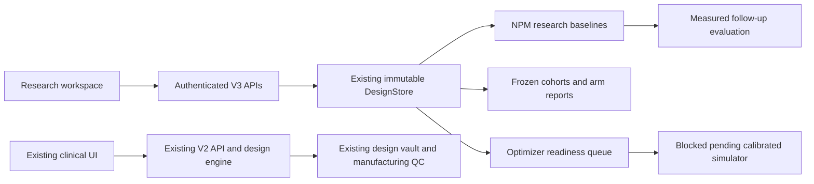

> Historical snapshot from 23 October 2026. Superseded by [the 26 October engineering report](COMPLETION_2026-10-26.md).

# NSO V3 research integration and readiness review

Prepared 23 October 2026 for the existing NSO AI-PC project. The software changes implement a research workspace and verifiable data/analysis foundations. They do **not** complete a clinically validated V3.0 or V3.1 release.

## Delivered behavior

The existing clinical fitting page links to `/research`. The new page links the verified publication, runs an isolated synthetic forecast without reading patient records, and provides an authenticated workspace for existing cases. Researchers can import explicit dated per-eye observations, record exposure intervals, forecast research baselines, evaluate measured follow-up, freeze study cohorts and export descriptive arm reports. Engineering users can submit and inspect asynchronous optimizer-readiness jobs. The optimizer reports a missing calibrated simulator without generating numerical optical outputs or designs.

The two executable forecast comparators are last measured value and within-eye linear regression over real elapsed days. They have no fitted population parameters, no validated prediction intervals and no claim to be the published Transformer. Forecasts require untreated-history attestation and check recorded V3 exposures. Missing/imputed endpoints remain explicitly labeled; only accepted measured data enter these baseline forecasts and primary evaluation. Patient history after the frozen index is excluded.

## Requirement disposition

| Requested area | Implementation / evidence | Remaining dependency |
|---|---|---|
| Reuse existing platform | Existing Next.js UI, FastAPI, immutable DesignStore, case IDs, design vault, model governance, manufacturing/QC preserved | Production configuration and database inspection |
| Sprint 0 inventory | `inventory.json`, source hashes, route inventory, entity mapping, regression baseline | Hosting settings, backup/restore drill, consent/data residency review, signed owners |
| Longitudinal contracts | Strict ISO-date per-eye observations, units/ranges, separate measured/imputed status, duplicate-date checks, atomic observation batches | Independent device/source data-quality verification |
| Exposure history | Dated arm, optional design link, adherence and discontinuation fields; overlapping recorded intervals rejected | Complete treatment history and protocol-controlled concurrent writers |
| NPM | Two transparent research comparators, per-horizon output, abstention, source/artifact hash, frozen history and existing Model Registry Development record | Cohort data; age-adjusted mixed-effects, boosted baselines, trained Transformer; calibrated uncertainty; external/prospective validation |
| IPM | Frozen 12-month cohorts, explicit comparator, declared assignment, analysis-plan text, measured endpoints, switching/discontinuation exclusions, descriptive summaries weighted by patient | Verified assignment, full target-trial protocol, covariates/propensity/censoring model, adjusted effects, overlap and sensitivity analyses, adequate sample size |
| Optical optimizer | Asynchronous request/result contract, durable job records, recovery command, reproducible seed/envelope reference | Simulator, measured-lens calibration, protected design-space schema, approved manufacturing constraints, actual multiobjective search/Pareto output |
| Approval controls | V3 optical approval fails closed; no V3 manufacturing release; adaptive ranking always false | Validated candidates, independent approval authority, manufacturing/QC evidence |
| Outcome evaluation | Recalculates baseline at actual measured follow-up date; residual and annualized change use actual days | Calibrated outcome model and uncertainty evaluation |
| Model validation | Executable patient-disjoint baseline benchmark, temporal endpoint/index separation and external-site checks, patient-weighted MAE/RMSE/bias, locked raw dataset snapshot | Prespecified acceptance thresholds, subgroup calibration, interval coverage, independently audited data |
| API/auth | OpenAPI 3.1, server-owned roles/patient lists, no clinical data browser storage, no-store responses, atomic SQL idempotency receipts, audit events | Identity-provider integration, credential lifecycle, full security review |
| Staging/CI | Local browser verification, backend tests, frontend production build, CI workflow and deployment settings | Remote CI execution and selected staging deployment |
| V3.1 | Explicitly unavailable | Prospective data, ethics/privacy authorization, locked validation, causal validity, shadow-mode evaluation and regulatory determination |

## Architecture and existing entity reuse



V3 domains use existing `domain_records`; no V2 normalized table is renamed or dropped. An additive `v3_operations` table handles request receipts. Migration SQL is in `src/backend/migrations/v3_001.sql`; runtime schema initialization applies the same table. `Patient/Case/Eye/Visit` remain canonical V2 identities. The conservative V2 observation adapter imports only unambiguous objective accepted AL/SE measurements. Explicit V3 observations take precedence for that date. It does not derive SE from partial sphere/cylinder records or infer missing AL.

The V3 trace endpoint joins research history, predictions, outcomes, jobs and model artifacts to the existing redacted case/product trace. Benchmark reports are included only when the session can access every patient in their frozen dataset. Manufacturing recipe details stay in the existing restricted store.

## Access and deployment

V3 authentication always fails closed if unconfigured, including local development. Bearer tokens resolve to unique server-configured actors, roles and explicit patient IDs; role headers cannot elevate access. Store only token hashes in `NSO_V3_PRINCIPALS`, and provision credentials outside source control. The UI holds a session token in React memory and clears it on disconnect. It does not persist patient data or credentials in browser storage.

Features default off: `NSO_V3_NPM_ENABLED`, `NSO_V3_IPM_RESEARCH_ENABLED`, `NSO_V3_OPTIMIZER_ENABLED`. The public synthetic demo is independent of these flags and uses a disposable in-memory store. No adaptive-ranking implementation can be enabled by an environment variable.

`api:app` adds V3 routes to the existing API. `research_app:app` provides a V3-only deployment with no legacy V2 routes. Set `NSO_V3_SERVICE=npm|ipm|optimizer|all` to split the service surfaces, and route them through a gateway sharing the same durable database. The V3-only app permits only configured CORS origins. The legacy combined app retains existing CORS and V2 authentication behavior; V3 authentication does **not** secure the older V2 clinical/manufacturing endpoints.

GitHub deployment metadata was read: the last listed production frontend/backend deployments were 8 October 2026, with Vercel and Render targets. This work has not inspected their live environment variables, cloud database, backup procedures, domain configuration or patient records. No production deployment has been performed.

## Reproduction and validation

From the repository root:

```sh
.venv/bin/python -m pytest -q src/backend
.venv/bin/python src/backend/scripts/v3_inventory.py > docs/v3/inventory.json
.venv/bin/python src/backend/scripts/v3_openapi.py > docs/v3/openapi.json
```

From `src/frontend`, run `npm run build` and `npm run start`. From `src/backend`, run `../../.venv/bin/python -m uvicorn api:app --host 127.0.0.1 --port 8000`. Open `http://127.0.0.1:3000/research` and run the synthetic forecast. The synthetic history and displayed outcomes are invented software fixtures, never study evidence.

Before modification the backend suite had 473 passing tests and one skipped test. Current verification is recorded separately in `VALIDATION.md`, including the exact reason for the existing skipped threshold-sensitive test. It is not counted as passed. Frontend builds can warn when Google Fonts cannot be downloaded; fallback system fonts remain available.

## Rollback and recovery runbook

1. On staging, record the current deploy artifact, database backup and V2 baseline. Stop accepting V3 writes before restoring a snapshot.
2. Set all three V3 feature flags to false and remove session provisioning. The synthetic demo remains fixture-only. Revert the frontend/backend deploy to the previous application artifact to remove the research entry completely.
3. Keep V3 domain records and `v3_operations` receipts as audit history. The older V2 app ignores them. Do not delete V2 records or drop the new receipt table during rollback.
4. Verify the previous `/api/health`, clinical fitting, report export and existing case trace on staging. The local SQLite reopen and atomic-write rollback tests verify storage behavior; they are **not** a cloud backup/restore rehearsal.
5. Interrupted idempotency reservations return `OPERATION_PENDING`. Inspect audits and existing objects before any administrator recovery; do not clear reservations and blindly replay writes.
6. Queued optimizer readiness jobs can be recovered with `python scripts/v3_optimizer_worker.py` against the same database. This release records a blocked result; it does not run an optical search.

## Owners and release dependencies

The platform owner must verify production architecture, access isolation, credential rotation, migration permissions, durable storage and backup recovery. The clinical investigator must supply approved de-identified longitudinal data, full exposure histories, study definitions, adverse-event capture and permissions. An ML specialist must build and externally validate population models and uncertainty estimates. The optical engineer must supply a calibrated simulator, tolerances and approved design envelopes. Independent clinical/QA owners must sign off model promotion and any subsequent deployment intended for patient care.

Known engineering limits remain: the legacy store scans JSON domain records rather than indexed normalized research tables; exposure-overlap checks need transaction-level constraints before concurrent clinical imports; general audit writes and request completion are not one cross-domain transaction; pending reservations need administrative recovery; PostgreSQL integration has not been exercised against a live server; no cloud security review, regulatory determination or clinical sign-off has occurred. These limits prevent declaring a complete V3 release.
